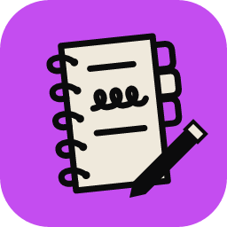
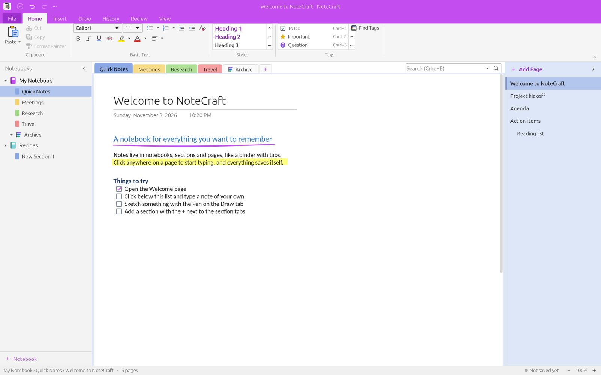
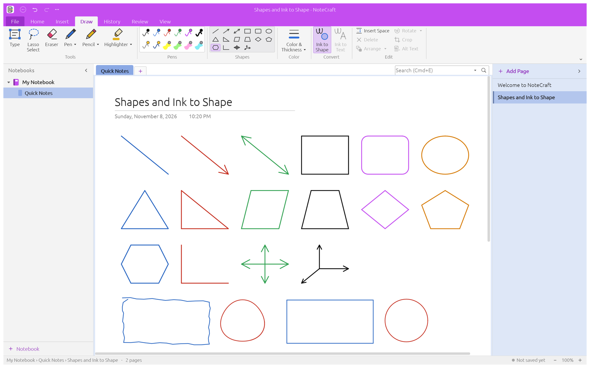
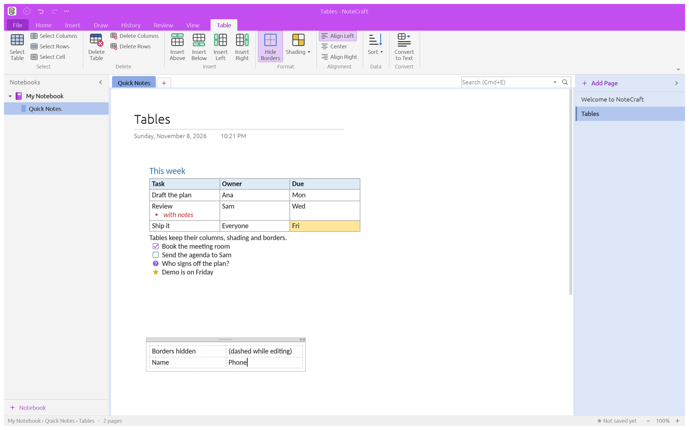
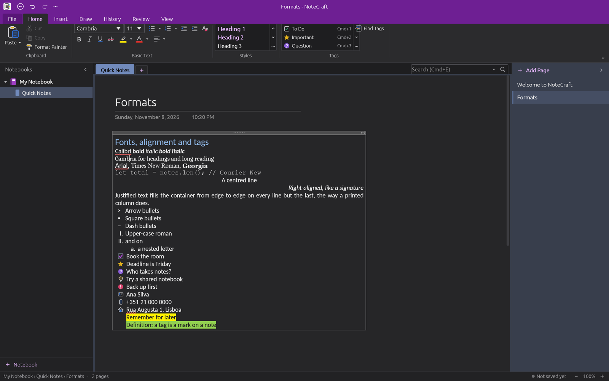

<p align="center">
  
</p>

<h1 align="center">NoteCraft</h1>

<p align="center">
  <b>Notebooks, sections, pages and ink: an open-source, clean-room OneNote-style notebook app in pure Rust.</b>
</p>

<p align="center">
  A fast, local-first notebook in the spirit of OneNote 2016/2019 for the Windows desktop:
  notebooks with section groups, sections and pages, note containers you place anywhere on a page,
  and a pen, pencil and highlighter with pressure. It stores notebooks as <code>.one</code> files,
  runs natively on macOS, Windows, Linux and FreeBSD, and in the browser via WebAssembly.<br>
  <i>A community Craft app by Ideademic.</i>
</p>

<p align="center">
  
  
  
  
</p>

> [!NOTE]
> **Made to fit in.** NoteCraft is a community Craft app by [Ideademic](https://github.com/Ideademic),
> made to fit in with the [ArtCraft](https://getartcraft.com/) team's open-source Crafting Apps
> (WordCraft, DeckCraft, GridCraft and the rest): the same Rust and egui stack, the same
> conventions, the same flat look. It is **not** an official ArtCraft app, and it is being
> submitted to the ArtCraft community beta. Come say hi in
> [the ArtCraft community](https://discord.gg/artcraft) on Discord.
>
> **ArtCraft team:** if you'd like to adopt NoteCraft as an official Craft app, I'd love that, and
> I'd be glad to stay on as a contributor. Reach out through the email address on my GitHub
> profile, [github.com/LazerThings](https://github.com/LazerThings).

> [!WARNING]
> **Files and Microsoft OneNote.** NoteCraft's `.one`, `.onetoc2` and `.onepkg` support is a
> clean-room implementation written only from Microsoft's published Open Specifications
> ([MS-ONESTORE] and [MS-ONE]). Reading files saved by OneNote 2010 and later aims at the common
> content: text, lists, tags, ink, pictures and printouts.
> **Writing `.one` files that Microsoft OneNote opens is experimental and unverified:** keep a
> backup before you let NoteCraft save into a notebook that OneNote also uses.

<p align="center">
  <a href="#a-tour">A tour</a> ·
  <a href="#what-works-today">What works today</a> ·
  <a href="#quick-start">Quick start</a> ·
  <a href="#files-and-formats">Files and formats</a> ·
  <a href="#architecture">Architecture</a> ·
  <a href="#roadmap">Roadmap</a> ·
  <a href="#downloads">Downloads</a> ·
  <a href="#the-crafting-apps">The Crafting Apps</a> ·
  <a href="#license">License</a>
</p>

## A tour

<p align="center">
  
</p>

<table>
<tr>
<td width="50%" valign="top"><p align="center"><sub><b>Draw.</b> Pen, pencil and highlighter with pressure, shapes and Ink to Shape.</sub></p></td>
<td width="50%" valign="top"><p align="center"><sub><b>Tables and tags.</b> Real tables with a Table tab, and tags you can summarize.</sub></p></td>
</tr>
<tr>
<td colspan="2"><p align="center"><sub><b>Dark mode.</b> Real fonts, alignment, list styles and tags.</sub></p></td>
</tr>
</table>

## What works today

Version 0.2.0 (see [CHANGELOG.md](CHANGELOG.md)):

| Area | Highlights |
|---|---|
| **Notebooks** | Notebooks, section groups, sections and pages, with colours; subpages; rename, reorder and delete; a Recycle Bin that keeps deleted pages and sections for 60 days |
| **Pages** | Click anywhere and type: note containers placed freely on the page; page titles with date and time (or hidden); page colour and rule lines; page templates, your own included; Insert Space |
| **Text** | Rich text in your installed fonts (or ones you add), bold, italic, underline, colour, highlight; paragraph styles, alignment, bullet and number styles, indent levels; Format Painter; Find and Replace on the page |
| **Tables** | Insert › Table and a Table tab: rows, columns, shading, hidden borders, sort, convert to text; Tab and the arrow keys move through cells; saved as real `.one` tables |
| **Tags** | To Do, Important, Question and eight more, with Ctrl+1…9; a Tags Summary of a page, section or notebook |
| **Links** | Web links, links to pages and paragraphs, `[[wiki links]]`; Ctrl+click to follow |
| **Ink** | Pen, pencil and highlighter with pressure, colours and widths; stroke eraser; lasso select; rotate and flip; Ink to Shape (rough lines, arrows, rectangles, circles and polygons redrawn clean as you draw) |
| **Shapes** | Draw › Shapes: lines, arrows, rectangles, ellipses, triangles, polygons and graph axes; saved as ink |
| **Insert** | Pictures (rotate, flip, crop, alt text, arrange); PDF file printouts you can ink over; file attachments; date and time |
| **History** | Page versions you can view and restore; unread pages and Next Unread; Recent Edits |
| **Review** | Spelling as you type with suggestions and a Spelling pane (English built in; other languages through installed Hunspell dictionaries); Word Count; proofing language per paragraph |
| **Clipboard** | Copy and paste formatted text, pictures, containers and ink; HTML and pictures from other apps; paste as plain text |
| **Files** | `.one` sections and `.onetoc2` notebooks as the native format (a notebook is a folder; OneNote 2010–2016 desktop files; OneDrive-packaged files are refused); `.onepkg` import and export; HTML, Markdown, plain-text and PDF export |
| **Printing** | File › Print with a preview, paper sizes and sheet ranges; Save as PDF |
| **Saving** | No Save button: changes autosave; crash recovery |
| **Search** | Page titles and text in a section, section group, notebook or every open notebook (Ctrl+F finds on the page) |
| **Looks** | Light and dark mode; a flat, purple ribbon, Classic or Simplified (single row), with Full-screen mode, Show tabs only and Always show ribbon; right-click menus throughout |
| **Everywhere** | Desktop on macOS, Windows, Linux and FreeBSD, with update checks; the browser via WebAssembly, with a host mode for embedding; a command-line tool |

Not there yet: nested tables, merged cells and pictures in table cells; equations; audio and
video; handwriting recognition (Ink to Text); interface translations (the app is English only
until craft-i18n's catalogs ship). Content NoteCraft can't show yet is kept in the file and shown
as a placeholder. `.one` files NoteCraft writes are still **unverified in Microsoft OneNote**, and
builds are **not code-signed**.

The honest picture, area by area, is in [ROADMAP.md](ROADMAP.md).

## Quick start

```sh
git clone https://github.com/Ideademic/NoteCraft
cd NoteCraft
cargo run --release -p notecraft                                # the desktop app
cargo run --release -p notecraft -- ~/Notebooks/"My Notebook"   # open a notebook folder (or a .onetoc2, .onepkg, .one)
```

Web: `cd apps/notecraft-web && trunk serve`, then open <http://127.0.0.1:8773/>
(needs `rustup target add wasm32-unknown-unknown` and [trunk](https://trunkrs.dev/)).

Command line:

```sh
notecraft-cli info "My Notebook"                    # notebook name, sections and page counts (JSON)
notecraft-cli dump "My Notebook/Open Notebook.onetoc2"   # the whole notebook as JSON
notecraft-cli convert Notes.onepkg Notes.html       # by the output's extension: .onepkg, .one, .html, .md, .txt, .json
notecraft-cli convert "My Notebook" Backup.onepkg   # pack a notebook folder
notecraft-cli commands                              # every command the app knows
```

`cargo run -p notecraft-cli -- …` runs it from a checkout.

## Files and formats

| Extension | What it is | NoteCraft |
|---|---|---|
| `.one` | A section: its pages, note containers, ink, pictures and printouts | Native format: read and write (writing for OneNote is experimental) |
| `.onetoc2` | A notebook's table of contents (`Open Notebook.onetoc2`) | Read and write |
| `.onepkg` | A whole notebook packed in one Cabinet file | Import and export |
| `.html`, `.md`, `.txt` | Pages as web pages, Markdown or plain text | Export |

A notebook is a folder: `Open Notebook.onetoc2` plus one `.one` file per section, with a
subfolder per section group. The readers and writers follow Microsoft's Open Specifications
([MS-ONESTORE], [MS-ONE], [MS-DTYP], [MS-OSHARED], [MS-CAB]) and nothing else: no other OneNote
implementation's code was read or ported. Every file is treated as hostile input; a malformed
file gives an error, never a crash.

## Architecture

| Layer | Crate | Job |
|---|---|---|
| L0 | `notecraft-geom` | points, half-inches, ink units, zoom, rectangles |
| L0 | `notecraft-fonts` | installed fonts, the bundled [craft-fonts](https://github.com/storytold/craft-fonts) faces, fonts you add |
| L1 | `notecraft-doc` | the model: notebook ▸ section groups and sections ▸ pages ▸ note containers (paragraphs and tables), pictures, printouts, attachments and page ink; page versions and the recycle bin |
| L2 | `notecraft-onestore` | the [MS-ONESTORE] revision store: header, file node lists, property sets, transaction log, CRCs |
| L2 | `notecraft-one` | [MS-ONE] mapping between the store and the model; `.onetoc2`; notebook folders |
| L2 | `notecraft-onepkg` | `.onepkg` (Cabinet) import and export |
| L2 | `notecraft-formats` | HTML, Markdown and text export; the HTML clipboard; picture import |
| L3 | `notecraft-printout` | PDF pages to pictures for file printouts ([craft-pdf](https://github.com/storytold/craft-libs)) |
| L3 | `notecraft-pdf` | pages to PDF for export and printing ([craft-pdf](https://github.com/storytold/craft-libs)) |
| L4 | `notecraft-engine` | session, commands, undo, autosave, storage |
| L6 | `notecraft-ui-egui` | the egui front end (swappable) |
| apps | `notecraft`, `notecraft-cli`, `notecraft-web` | desktop, command line, browser |

Everything the user can do is a command with an id, dispatched through one `Session`; the
ribbon, keyboard shortcuts, the CLI and the tests all use the same commands. `cargo xtask ci`
runs rustfmt, clippy, the tests, the asset-attribution check, the layering check and the wasm
build. Contributor and agent instructions: [AGENTS.md](AGENTS.md) and
[CONTRIBUTING.md](CONTRIBUTING.md). Terms: [GLOSSARY.md](GLOSSARY.md).

## Roadmap

NoteCraft is in **early alpha**. Next up: verifying `.one` writing against real Microsoft OneNote,
more of what real OneNote files hold (merged and nested table cells, equations, audio), interface
translations, and signed releases. Details: [ROADMAP.md](ROADMAP.md).

## Downloads

**Download NoteCraft** from GitHub: the [latest release](https://github.com/Ideademic/NoteCraft/releases/latest) has every build listed below, and [all releases](https://github.com/Ideademic/NoteCraft/releases) has earlier versions. `<ver>` in the file names is the version number, and `SHA256SUMS.txt` lists a checksum for every file.

> [!NOTE]
> Early builds are **not code-signed** yet. macOS builds are ad-hoc signed and not notarized:
> right-click the app and choose **Open** the first time. Windows SmartScreen may warn about an
> unknown publisher: choose **More info › Run anyway**.

### Windows

| Build | Installer | Portable |
|---|---|---|
| x64 (64-bit Intel/AMD) | `notecraft-<ver>-windows-x64.msi` | `notecraft-<ver>-windows-x64-portable.zip` |
| arm64 (Snapdragon and other ARM PCs) | `notecraft-<ver>-windows-arm64.msi` | `notecraft-<ver>-windows-arm64-portable.zip` |
| x86 (32-bit) | `notecraft-<ver>-windows-x86.msi` | `notecraft-<ver>-windows-x86-portable.zip` |

The installer installs for your account only by default, into
`%LOCALAPPDATA%\Programs\Ideademic\NoteCraft`, with no administrator rights; choosing "Everyone on
this computer" installs into `C:\Program Files\Ideademic\NoteCraft` and asks for an administrator.
NoteCraft registers as an *Open with* choice for `.one`, `.onetoc2` and `.onepkg` but never takes
those files over from OneNote; make it the default in Settings › Default apps if you like.

### macOS

| Build | File |
|---|---|
| App, universal (Apple silicon + Intel) | `notecraft-<ver>-macos-universal.dmg` |
| Command-line tool, universal | `notecraft-cli-<ver>-macos-universal.zip` |

### Linux

| Format | x86_64 | aarch64 (ARM64) | Notes |
|---|---|---|---|
| AppImage | `notecraft-<ver>-linux-x86_64.AppImage` | `notecraft-<ver>-linux-aarch64.AppImage` | Runs anywhere; delta updates through the `.AppImage.zsync` files |
| Flatpak | `notecraft-<ver>-linux-x86_64.flatpak` | `notecraft-<ver>-linux-aarch64.flatpak` | Sandboxed; `flatpak install --user <file>` |
| Debian/Ubuntu | `notecraft-<ver>-linux-x86_64.deb` | `notecraft-<ver>-linux-aarch64.deb` | |
| Fedora/RHEL/openSUSE | `notecraft-<ver>-linux-x86_64.rpm` | `notecraft-<ver>-linux-aarch64.rpm` | |
| Arch Linux | `notecraft-<ver>-linux-x86_64.pkg.tar.zst` | `notecraft-<ver>-linux-aarch64.pkg.tar.zst` | `sudo pacman -U <file>` |
| Tarball | `notecraft-<ver>-linux-x86_64.tar.gz` | `notecraft-<ver>-linux-aarch64.tar.gz` | Unpack anywhere |

RISC-V (riscv64): `notecraft-<ver>-linux-riscv64.deb`, `.rpm` and `.tar.gz`, cross-compiled for
glibc 2.39+ (Ubuntu 24.04, Debian 13 and newer).

### FreeBSD

| Build | File |
|---|---|
| x86_64 | `notecraft-<ver>-freebsd-x86_64.tar.gz` |
| aarch64 | `notecraft-<ver>-freebsd-aarch64.tar.gz` |

Unpack into `/usr/local`: `tar -xzf notecraft-*-freebsd-x86_64.tar.gz --strip-components 1 -C /usr/local`.

### Web (WebAssembly)

| Build | File | Notes |
|---|---|---|
| Static site | `notecraft-web-<ver>.zip` | Runs in a modern browser; host it on any static server ([hosting notes](packaging/web/README.md)) |

## The Crafting Apps

NoteCraft is made to fit in with the **Crafting Apps**: free, open-source creative tools from the
[ArtCraft](https://getartcraft.com/) team, each written from scratch in Rust. NoteCraft itself is a
community app, not one of the official ones. Some of the apps it sits beside:

| App | What it's for | Code |
|---|---|---|
| **WordCraft** | Word processing and documents | [storytold/wordcraft](https://github.com/storytold/wordcraft) |
| **DeckCraft** | Presentations and slide decks | [storytold/deckcraft](https://github.com/storytold/deckcraft) |
| **GridCraft** | Spreadsheets and data | [storytold/gridcraft](https://github.com/storytold/gridcraft) |
| **PdfCraft** | Reading, organizing and protecting PDFs | [storytold/pdfcraft](https://github.com/storytold/pdfcraft) |
| **PhotoCraft** | Image editing | [storytold/photocraft](https://github.com/storytold/photocraft) |
| **VectorCraft** | Vector illustration | [storytold/vectorcraft](https://github.com/storytold/vectorcraft) |
| **DesignCraft** | Page layout and publishing | [storytold/designcraft](https://github.com/storytold/designcraft) |

The full list is at [getartcraft.com/apps](https://getartcraft.com/apps). NoteCraft builds on their
shared [craft-libs](https://github.com/storytold/craft-libs) and their forks of egui and winit.

## License

NoteCraft is licensed under either of the [MIT License](LICENSE-MIT) or the
[Apache License, Version 2.0](LICENSE-APACHE), at your option. Copyright © 2026 Ideademic and
NoteCraft contributors. Third-party material and assets: [NOTICE](NOTICE) and
[ATTRIBUTION.md](ATTRIBUTION.md). Security reports: [SECURITY.md](SECURITY.md).

Microsoft, OneNote and Office are trademarks of the Microsoft group of companies. NoteCraft is an
independent project and is not affiliated with or endorsed by Microsoft. ArtCraft is the ArtCraft
team's; NoteCraft is not affiliated with or endorsed by them.
